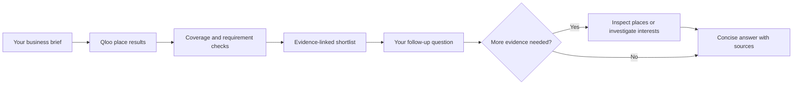

<div align="center">

# XenoScope

### Before you sign. Know what to investigate.

Evidence-linked location research for your next business idea.

<p>
  <a href="https://xenoscope.vercel.app/"></a>
  <a href="#run-locally"></a>
</p>

<p>
  <a href="https://github.com/mhamzanadeem/QLOO---XenoScope/stargazers"></a>
  <a href="https://github.com/mhamzanadeem/QLOO---XenoScope/forks"></a>
  <a href="https://github.com/mhamzanadeem/QLOO---XenoScope/actions/workflows/checks.yml"></a>
  <a href="LICENSE"></a>
  
</p>

[Live demo](https://xenoscope.vercel.app/) · [Run locally](#run-locally) · [How it works](#how-it-works) · [Guide for judges](#guide-for-judges) · [Architecture](#architecture)

<a href="https://xenoscope.vercel.app/">
  
</a>

<p>
  
  
  
  
  
</p>

</div>

## A clearer next step for business owners

XenoScope helps you compare cities, explore culturally relevant places, and build
an evidence-linked research shortlist before committing to a location. Start with
your concept, audience, and requirements; investigate what Qloo returns; then ask
the research assistant to help you explore further.

| | What you can do |
| --- | --- |
| 📍 **Compare locations** | Review two cities using the same selected interests and reference businesses. |
| 🔎 **Inspect the evidence** | Open returned places, inspect documented features, and follow available source links. |
| 💬 **Discuss your results** | Ask follow-up questions with your brief and comparison in context; let the assistant choose relevant Qloo research tools. |
| 🧭 **Plan your next move** | Build a visit shortlist, identify unknowns, and use a practical site-visit checklist. |
| 📁 **Keep your research** | Save explorations in your browser and export JSON or CSV reports. |

> Cultural relevance informs research. It does not establish customer demand,
> profitability, foot traffic, or business success.

## How it works



The initial comparison follows a bounded research workflow. The optional assistant
can choose tools for fresh Qloo research, then use their returned evidence in its
answer. Follow-up samples are labelled separately from your original comparison.

**Try it:** [Open City vs City](https://xenoscope.vercel.app/build/market), choose
an example brief, enter two cities, and select verified interests. Run the
comparison, inspect a place, then ask **“What should I investigate next?”**

---

## Guide for judges

<details>
<summary><strong>Open the complete walkthrough: scenarios, evidence, findings, and exports</strong></summary>

### 1. Open the application

Open **[xenoscope.vercel.app](https://xenoscope.vercel.app/)**. The application
does not require an account.
The deployment owner configures provider keys on the server; judges should not need
to supply keys when using the hosted demo.

To evaluate locally, follow **Run locally** below. A working Qloo key is required
for live comparisons. OpenAI is optional. Missing provider access is reported
explicitly; the application does not substitute fictional results.

### 2. Choose a workflow

On the homepage, click **Start exploring** to go directly to **City vs City**
(`/build/market`). Old `/explore` links redirect there. Other workflows remain
available from the homepage cards:

| Workflow | Question it helps investigate |
| --- | --- |
| **City vs City** | What relevant places and documented features are returned in two cities? |
| **Venue vs Venue** | What place recommendations relate to two selected reference venues? |
| **Concept vs Concept** | What place samples match two verified interests in the same city? |

City vs City is the main investor workflow. Its route remains `/build/market` for
compatibility; `market` is an internal API mode, not another product feature.

### 3. Try a City vs City scenario

Above the form, open **Try a scenario**. Five editable examples are available:

- Reading cafe for students.
- Family restaurant.
- Hotel for business travellers.
- Neighborhood grocery shop.
- Bookshop and stationery.

Selecting a scenario fills the business description, audience, required features,
and illustrative constraints. It also searches Qloo for up to three distinct
place-related interests and three reference businesses. The form reports how many
live matches were found. Fewer than three matches is a valid outcome; missing
matches are not invented.

**Both city fields intentionally remain blank.** Enter your own cities. Worldwide
suggestions show state and country to distinguish names; manual entry is supported.
Being listed in the city dataset does not guarantee Qloo coverage.

A possible test brief is a reading cafe for students and remote workers, comparing
Lahore and Islamabad. These names are an input example, not a promise of coverage,
results, or a recommendation to invest in either city.

### 4. Review the form

| Field | What to enter or check |
| --- | --- |
| Business concept | A short description of the business, 2–100 characters |
| Who is it for? | Your intended customers; this is a research assumption |
| Required features | Up to 12 comma-separated requirements, such as Wi-Fi or reading space |
| Decision | City vs City investigates which cities to research further; it does not select a property |
| Constraints | Your budget, seating needs, hours, or other practical requirements |
| City A / City B | Two different city names, optionally including state/country |
| Reference businesses | Optional known examples whose style should guide recommendations |
| Cultural interests | Select live search results; typing text alone is not a selection |

Up to three reference businesses and three interests can be selected and removed.
These are application request caps, not a claim that Qloo limits all integrations
to three inputs. Multiple interests use **any-match / OR semantics**: each interest
is queried separately in both cities, then duplicate places are combined. More
interests broaden the sample; they do not guarantee more relevant results.

Review automatically selected references. They are examples returned by search,
not endorsements or businesses independently verified by XenoScope.

### 5. Run the comparison

Click **Run comparison**. The button displays request progress and elapsed time.
City vs City automatically runs the bounded research workflow:

1. Retrieve Qloo place results for both cities using the same interests/references.
2. Assess how much returned place metadata is available.
3. Search alternative interests if coverage is limited.
4. Prepare deterministic requirement checks and an optional AI-assisted brief.

Comparison requests impose no application timeout and make no automatic provider retries.
The interactive assistant has a separate 50-second total budget, at most three Qloo
tool calls and four AI calls per question, and no automatic retries.
Network, proxy, provider, and hosting limits can still terminate a request. The
Vercel function is configured for 60 seconds; removing client timeouts cannot
remove platform limits.

### 6. Read the results

The left **Results page outline** links to sections within the current report.
On mobile it becomes compact section navigation.

- **Overview:** a conditional next action, explicit requirement matches, and unknowns.
- **City snapshots:** returned-place counts and available feature metadata.
- **Places to investigate:** searchable place lists and links to findings.
- **Compare what matters:** feature counts, charts, filtering, and sorting.
- **Evidence table:** inspect the places supporting a particular feature count.
- **Insights to act on:** shown when OpenAI produces a validated brief.
- **Discuss your results:** ask follow-up questions with the comparison already in context. The assistant can inspect returned places, search verified Qloo interests, and retrieve fresh city samples. Sources and actual research actions are expandable; follow-up samples do not replace the original report.
- **Research activity:** actual tool steps and optional AI outcome.
- **Before you commit:** a temporary site-visit checklist; checks are not saved or verified.

Requirement matching uses exact normalized feature names, ignoring punctuation.
It is not a semantic verification that a business meets the complete concept.
Unmatched requirements remain unverified; missing metadata does not prove absence.

The AI brief is labeled as suggestions. Its citations must refer to places supplied
to the model. Citation validation checks source membership, not the truth of every
generated statement. Customer demand, rent, complete competitor counts, and financial
feasibility remain unknown without additional evidence.

### 7. Filter and paginate places

Each Qloo Insights request asks for **50 places**, the documented maximum per page.
With three interests, a city page can contain up to 150 places before deduplication.

- Each city's visible list has 10-place pagination.
- Search by place name, address, or city.
- Filter by a returned feature, available location, or website.
- Use **Load next Qloo page** to request another upstream page.
- Use **Previous Qloo page** to return.

Loading another Qloo page replaces the displayed sample. Counts and charts describe
that page, not every business in the city. A full upstream page enables Next; the
next page may be empty because total counts are not assumed. Pages load on demand,
not through an automated citywide download.

The feature table also has 10-row pagination. Its filters combine name search,
category, shared/one-sided presence, minimum place count, minimum absolute count
difference, and sorting. **Reset filters** restores the default view.

### 8. Open a finding

Click a place or a feature's evidence link.

For a **place**, the app shows the existing evidence immediately, fetches additional
Qloo entity information when opened, and then requests an optional AI visit brief.
While enrichment is pending it shows **We are fetching more details…**.

Available fields include description, address, coordinates, business website,
returned social URLs, and other source properties. Phone, price level, rating,
hours, or hotel class are shown when present. Expand **All available place
information from Qloo** for the returned property/external metadata.

**Open Google Maps** uses source coordinates or an address search. It is not an
independently verified Google business listing. Instagram and other links are
shown only when supplied as URLs; the app and LLM do not guess missing accounts.
The AI interprets supplied information; it does not independently research new
addresses, opening hours, reviews, or social profiles.

For a **feature**, inspect which returned places carry it. Technical IDs and query
provenance are expandable. `/guide` explains the terminology in plain English.
Failed enrichment preserves the original evidence and displays a message.

### 9. Save and export

Use **Save exploration** to save the current result in this browser. Open **Saved
explorations** to reopen or delete it. Saves are limited to 30 and are not synced.
Browser storage can be cleared; export important work.

Use **Export report** for JSON/CSV, or the print control for browser PDF printing.
JSON preserves the business brief, source results, and derived decision evidence.
CSV provides feature counts, methodology, and source provenance. Local results and
exports are research artifacts, not authenticated certificates from Qloo.

### Suggested judging checks

1. Apply a scenario, enter two cities, review live selections, and run it.
2. Follow an evidence link and check its supporting places and source details.
3. Use filters, change table pages, and request another Qloo page if available.
4. Open a place and observe on-demand details/AI loading.
5. Save, reopen, and export the result.
6. Try a query with no matches: the app should explain the empty sample, not invent results.

A missing AI key should preserve Qloo results. A failed Qloo request must not be
presented as a successful illustrative comparison.

</details>

## Run locally

Requirements: Node.js 22.12+ and npm. The project was checked with Node.js 24.18.
No Python, separate database, or paid map API is required.

```powershell
cd C:\QLOO---XenoScope
npm ci
if (!(Test-Path .env.local)) { Copy-Item .env.example .env.local }
```

Set these values in `.env.local` using your own credentials:

```dotenv
QLOO_API_KEY=your_key
QLOO_BASE_URL=https://hackathon.api.qloo.com
OPENAI_API_KEY=your_optional_openai_key
OPENAI_MODEL=gpt-5.6-luna
```

Use the Qloo host assigned to your key. Allowed hosts are the official production,
staging, and hackathon origins. Never put keys in a `VITE_` variable, frontend code,
screenshots, Git, or a submission description.

```powershell
npm run dev
```

Open the URL printed by Vite, usually `http://127.0.0.1:5173`. If that port is in use,
Vite may choose another. The development plugin serves both frontend and API.
Restart after changing environment variables.

`country-state-city` is included in the locked dependencies for worldwide city
suggestions. Its dataset does not claim to contain every settlement.

```powershell
npm run build
npm run preview
```

**Preview serves static assets only.** Use `npm run dev` for API-enabled local use.

## AI cost controls

The optional AI brief uses `gpt-5.6-luna`, reasoning effort
`none`, and a 1,400-output-token limit. It sends a compact selection of evidence,
not the full Qloo response. The brief makes no tool calls and has no automatic retries
or larger-model fallback. The interactive assistant has a separate budget: up to
three Qloo tool calls and four AI calls per question, 1,600 output tokens per AI
call, and a 50-second total deadline. Identical summaries are cached for ten minutes per
process, up to 100 entries. Token usage is visible on successful briefs.

Entity details are cached for ten minutes per process, up to 250 entries; concurrent
identical detail requests share one lookup. Serverless instances do not share these
caches. `store:false` disables Responses application storage, not all provider retention.

## Architecture

```text
api/index.js           Vercel entry point
server/router.js       Validated same-origin API routes
server/qloo.js         Live Qloo requests, paging, normalization and entity lookup
server/research.js     Coverage assessment and conditional alternative search
server/ai.js           Bounded, source-linked AI synthesis
server/assistant.js    Results-aware conversation and validated Qloo tool execution
server/cities.js       Server-side worldwide city suggestions
shared/schema.js       Request/result validation
shared/compare.js      Counts, source normalization, report generation
shared/decision.js     Deterministic investor brief and requirement matching
src/App.jsx            Homepage, forms, results, findings, saves and reports
src/ResearchAssistant.jsx  Follow-up questions, sources and research activity
src/CitySearch.jsx     City autocomplete
src/scenarios.js       Editable input examples, not fictional results
src/labels.js          Readable source labels
src/SignalChart.jsx    Lazy-loaded chart
src/store.js           Browser saves and API helpers
src/styles.css         Light theme, responsive layout, print and focus styles
tests/                 Unit/component tests and synthetic test-only fixtures
e2e/                   Mocked-provider browser workflows
.github/workflows/     Lint, unit tests and production build checks
```

## API routes

| Method | Route | Purpose |
| --- | --- | --- |
| GET | `/api/health` | Server health |
| GET | `/api/config` | Safe configuration flags |
| GET | `/api/qloo/status` | Authenticated search-access check |
| GET | `/api/cities/search?q=` | Worldwide city suggestions |
| GET | `/api/entities/search?q=` | Place search |
| GET | `/api/entities/details?id=` | On-demand entity details |
| GET | `/api/tags/search?q=` | Live interest lookup |
| GET | `/api/insights` | Validated place recommendations |
| POST | `/api/compare` | Comparison; City vs City includes research |
| POST | `/api/research` | Explicit bounded research workflow |
| POST | `/api/assistant` | Results-aware conversation with bounded Qloo tools |
| POST | `/api/places/page` | Another comparison-result page |
| POST | `/api/findings/brief` | Optional AI analysis for an opened place |
| GET | `/api/trends` | Validated, labeled raw trend response; no trend chart |
| POST | `/api/report` | Validated JSON/CSV export |

## Checks and verification

```powershell
npm run lint
npm test
npm run build
npx playwright install chromium
npm run test:browser
```

Latest code checks: lint and production build passed; 57 unit/UI tests passed.
Five browser workflows passed against the production build using intercepted
assets and mocked providers, including the results assistant, new-tab finding restoration, AI error recovery, direct city entry,
390px layout, persistence, and CSV export (using the real report handler).
The sandbox blocks loopback connections, so the normal preview-server browser
run was unavailable; an ignored local QA harness served the built files through
Playwright interception using installed Chrome. Desktop/mobile screenshots were
inspected. Provider integrations were tested with mocks, not live API calls.

Successful hosted routing, current Qloo geographic/account coverage, and live
OpenAI completion have not been verified in this execution environment. The user
previously demonstrated a successful authenticated Qloo search; that does not
establish every Insights/detail combination. No deployment was performed here.

## Deployment

**Live application:** [xenoscope.vercel.app](https://xenoscope.vercel.app/)

Import the repository into Vercel. Use `npm ci`, `npm run build`, and output `dist`.
Configure server keys there. `vercel.json` supplies API/SPA routing and headers.
The Node function has a configured 60-second limit; confirm your plan supports it.
Test deep links, all provider requests, findings, paging, exports, and mobile access
on the deployed URL before submission. Keep judge access available during judging.

## Limits and security

- No commercial viability, demand, revenue, or success prediction.
- City comparisons do not determine the best neighborhood or property.
- Place samples and metadata can be incomplete; a missing feature is not absence.
- No synthesized demographic, heatmap, or financial output. Trends are raw only.
- Body limits: 150 KB for query requests; 4 MB for reports and finding briefs.
- Inputs, hostnames, result structures, and clickable URLs are validated.
- React renders source text safely; CSV cells are guarded against formula injection.
- Public configuration omits secrets. Provider errors omit raw bodies and credentials.
- Rate limiting is per-instance and best-effort; production needs platform abuse controls.
- Public endpoints can consume provider quota; use appropriate deployment usage limits.
- Saved/exported content is client supplied and is not cryptographically authenticated.

## Repository scope and license

Keep source, build/deploy configuration, public assets, tests, README, and LICENSE
in Git. `.gitignore` excludes credentials, dependencies, generated output, local
commit helpers, retired demo datasets/generators, and old planning documents.
Synthetic data under `tests/fixtures` is used only for automated verification.
Application requests and result schemas accept live Qloo data only.

Application source is MIT licensed; see [LICENSE](LICENSE). Dependencies and Qloo
content remain subject to their respective terms.

Official references: [Qloo Insights](https://github.com/qloo/docs-public/blob/main/reference/insights-api-deep-dive.md),
[entity lookup](https://github.com/qloo/docs-public/blob/main/reference/get-entities.md),
[hackathon submission guide](https://github.com/qloo/qloo-hackathon-kit/blob/main/docs/SUBMISSION.md),
and [OpenAI model documentation](https://developers.openai.com/api/docs/models/gpt-5.6-luna).

## Results research assistant

Configure `OPENAI_API_KEY` and the existing `OPENAI_MODEL=gpt-5.6-luna` on the
server. Missing configuration is shown explicitly. The assistant uses the OpenAI
Responses API with strict function schemas and structured answers. It chooses
whether to answer from the report or call `inspect_place`, `search_interests`,
and `investigate_interest`. Interest investigations are restricted to verified
tags and the original locations. Venue comparisons support place inspection and
interest lookup, without inventing a city.

Each question includes the business brief, original returned places (bounded
descriptions and feature lists), deterministic requirement checks, research
activity, the original AI brief, up to 24 previously cited follow-up places,
and the most recent eight conversation messages. Sources are restricted
to supplied or newly retrieved place IDs. Provider failures are surfaced in the
action trace. Transport errors distinguish connection problems, platform timeouts,
API access, and invalid/incomplete AI output. Failed questions remain editable,
and unavailable visit briefs can be retried. AI request payloads omit raw source
metadata; full metadata remains available for inspection and export.

Navigation links open new tabs; in-page section links stay in the current tab.
Up to three recent comparisons are cached separately in browser storage for
24 hours so finding/report tabs can restore their context after refresh. If
browser storage cannot hold the comparison, navigation falls back to the current
tab to preserve it. These temporary snapshots are separate from saved reports.

Conversations are kept in component memory while the results page
is open; they are not included in saved reports or exports. Original reports are
client supplied, as with the existing report APIs; follow-up tool results come
from server-side Qloo calls. No web search, rent lookup, or demand prediction is
provided. The assistant does not replace the original comparison with its samples.

Implementation follows the [official OpenAI function-calling documentation](https://developers.openai.com/api/docs/guides/function-calling).

---

<div align="center">

Built by [Muhammad Hamza Nadeem](https://github.com/mhamzanadeem) · [MIT licensed](LICENSE)

[Try XenoScope](https://xenoscope.vercel.app/) · [Report an issue](https://github.com/mhamzanadeem/QLOO---XenoScope/issues)

<sub>Stars, forks, build status, and license badges reflect their linked services. The README views badge counts badge views through hits.sh; it is not unique-user or website analytics.</sub>

</div>
